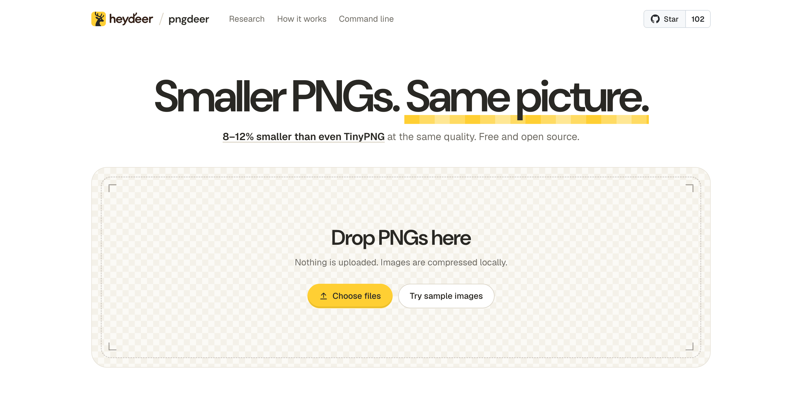

# pngdeer

**Smaller PNGs. Same picture.** pngdeer is a lossy PNG compressor with no quality slider: for each image it searches palette sizes from 2 to 256 colors, with and without dithering, scores each result with a perceptual metric, and keeps the smallest file that still looks right. At the same quality, the median image comes out **8–12% smaller than with TinyPNG**, the best result of any open-source compressor we've measured.

**[Try it in your browser →](https://heydeer.ai/open-source/pngdeer)** Nothing is uploaded: images are compressed on your device.

[](https://heydeer.ai/open-source/pngdeer)

```bash
brew install heydeer/tap/pngdeer
pngdeer input.png -o output.png
```

- **Picks the quality for you**: about what TinyPNG would give the image, never above 90 on SSIMULACRA2's scale, which is indistinguishable at 1:1.
- **Same bytes everywhere**: the command line (macOS and Linux) and the browser (WebAssembly, on every core) run the same Rust code and write identical files.
- **Big images too**: up to 40 megapixels in the browser, more on the command line.
- **JPEG photos too**: re-encoded with mozjpeg at the lowest quality that keeps the target, 13% smaller in total than TinyPNG's at its quality ([details](#jpeg)).
- **Animated PNGs stay animated**: every frame on one palette and at the target quality, timing kept; 28% of the original size on 12 animated emoji, about even to 16% smaller than TinyPNG ([notes](experiments/apng/FINDINGS.md)).
- **Free and open source**: MIT.

## Leaderboard

We ran pngdeer, TinyPNG and eight open-source quantizers on 180 PNGs: icons, UI screenshots, illustrations, photos, cut-outs and 3D renders. Every output was scored against its original with [SSIMULACRA2](https://github.com/cloudinary/ssimulacra2), a perceptual metric where 90 means indistinguishable at 1:1. TinyPNG is the yardstick:

- **Points**: median SSIMULACRA2 points above (+) or below (−) TinyPNG when a tool's file is as big as TinyPNG's.
- **Reaches**: images where a tool can match TinyPNG's quality at all.

Each cell gives the held-out set (71 images) / the tuning set (109 images):

| Compressor | Points | Reaches |
|---|---:|---:|
| **pngdeer** | **+1.7 / +2.0** | **67 / 106** |
| TinyPNG (the yardstick) | 0 | 71 / 109 |
| pngquant | 0.0 / +0.3 | 53 / 87 |
| quantizr | −0.1 / −1.0 | 39 / 53 |
| exoquant | −3.7 / −5.1 | 19 / 24 |
| NeuQuant | −6.5 / −9.8 | 4 / 5 |
| FFmpeg | −7.0 / −8.8 | 16 / 15 |
| quantette | −7.6 / −9.6 | 18 / 21 |
| ImageMagick | −11.3 / −14.5 | 3 / 8 |
| Pillow | −16.8 / −19.5 | 4 / 4 |

At TinyPNG's quality, pngdeer's files are 12% smaller on the held-out set and 8% smaller on the tuning set (median image).

- **Held out**: pngdeer's parameters were tuned on the 109 images; the other 71 were collected afterwards and never used for tuning.
- **Generous to the others**: each open-source tool gets its best of ten settings per image, picked after the fact. pngdeer's results are what you get, searched at compression time.
- **A second opinion**: scored with butteraugli instead, which the search never looks at, pngdeer's files are still 6–9% smaller than TinyPNG's at the same quality.
- TinyPNG ran through its API in October 2026. [bench/](bench/) reruns everything; the website screenshots in the sets aren't ours to share, so a rerun covers 155 of the 180 images.

### WebP

pngdeer also writes WebP (an output name ending in `.webp`, or the switch in the browser): the smaller of its palette image stored losslessly and the lowest lossy quality that keeps the target (a JPEG photo: [below](#jpeg)). Against TinyPNG's WebP on 120 of the images, the size each tool needs to match TinyPNG's quality (median image / in total), and how many images it can bring up to that quality:

| Compressor | Size at TinyPNG's quality | Reaches |
|---|---:|---:|
| **pngdeer** | **95.0% / 93.9%** | **118** |
| TinyPNG (the yardstick) | 100% | 120 |
| cwebp, best of 27 settings | 97.9% / 110.2% | 120 |
| pngquant + cwebp, best of 10 | 135.0% / 212.1% | 115 |

- **cwebp** is libwebp's own encoder, the library Squoosh, sharp and Pillow encode with. It gets its best of 27 settings per image, picked after the fact: 13 qualities with and without the auto filter, and lossless. **pngquant + cwebp** stores pngquant's palette image as lossless WebP, TinyPNG's palette route from open-source parts.
- At TinyPNG's file size, on the 40 images where all three can be compared, pngdeer scores 2.6 SSIMULACRA2 points above TinyPNG, pngquant + cwebp 1.9, cwebp −0.3.
- Out of the box, cwebp's default quality makes files 6% bigger than TinyPNG's on the median image, and slightly worse. pngdeer's automatic quality makes them 5% smaller, as good.
- WebP's settings were chosen on these 120 images. On the other 60, against a stand-in that matches TinyPNG's WebP on these (same size and score, median), pngdeer is 4% smaller. The [WebP notes](experiments/webp/FINDINGS.md) have the details.

### JPEG

pngdeer also takes JPEG photos (`pngdeer photo.jpg -o smaller.jpg`, or drop them in the browser) and writes a smaller JPEG: re-encoded with mozjpeg at the lowest quality that keeps the target, never bigger than the photo. On 60 photos from Wikimedia Commons, 30 web-size copies and 30 camera originals, the size each tool needs to match TinyPNG's quality (median photo / in total), and how many photos it can bring up to that quality:

| Compressor | Size at TinyPNG's quality | Reaches |
|---|---:|---:|
| **pngdeer** | **89.5% / 86.7%** | **60** |
| TinyPNG (the yardstick) | 100% | 60 |
| jpegli, best of 12 settings | 89.2% / 87.2% | 60 |
| mozjpeg, best of 7 qualities | 94.2% / 89.1% | 59 |

- **jpegli** is Google's JPEG encoder from the JPEG XL project, **mozjpeg** Mozilla's, which Squoosh uses. Each gets its best setting per photo, picked after the fact: qualities 40–90, jpegli also at 4:2:0. pngdeer's numbers are the files it writes, searched at compression time; its encoder is mozjpeg with its MS-SSIM-tuned table at 4:2:0, which given the same sweep needs 87.6% / 86.4%.
- At its automatic quality, pngdeer's files are 82% of TinyPNG's size on the median photo (84% in total), scoring about the same (median +0.2 points). mozjpeg's default quality makes them 7% bigger than TinyPNG's, 5 points better.
- Like TinyPNG, pngdeer gives big photos a lower quality than small ones: a large photo is seen scaled down. Unlike TinyPNG, it keeps the color profile (unless sRGB) and the orientation, and drops the rest of the camera's metadata.
- **WebP from a JPEG** (`pngdeer photo.jpg -o photo.webp`, or the switch in the browser): turned upright, at the same automatic quality. At TinyPNG's WebP quality it needs 95.3% / 91.3% of TinyPNG's WebP size; cwebp, given its best of 13 settings per photo, about the same. At equal quality it is no smaller than pngdeer's own JPEG (99% on the median photo), so it is there for sites that want WebP.
- The [JPEG notes](experiments/jpeg/FINDINGS.md) have the details. TinyPNG ran through its API in October 2026.

## How it works

- **Searches the palette**: palette sizes from 2 to 256 colors, each tried a few ways (with and without Floyd–Steinberg dithering, with neighbour smoothing, with a second palette builder), and the smallest file that reaches the target wins.
- **Scores what you'd see**: SSIMULACRA2, measured in-process. Colors are matched in Oklab, smooth gradients are always dithered, and transparent pixels are judged over light and dark backgrounds.
- **Stays fast on big images**: large images are searched on a downscaled preview and checked at full size.

The [research notes](experiments/palette-feedback/FINDINGS.md) follow every step, from the first comparison with TinyPNG to today's defaults.

## Command line

```bash
pngdeer input.png -o output.png              # automatic quality
pngdeer input.png -o output.png --target 85  # a fixed SSIMULACRA2 quality
pngdeer input.png -o output.webp             # WebP, automatic quality
pngdeer photo.jpg -o photo.min.jpg           # JPEG, automatic quality
pngdeer photo.jpg -o photo.webp              # a JPEG as WebP
pngdeer --help
```

From source: `cargo build --release`, and the binary is `target/release/pngdeer`.

## Browser

The [web app](web/) runs the same code compiled to WebAssembly. To run it locally ([web/build.sh](web/build.sh) lists the toolchain it needs):

```bash
sh web/build.sh
python3 web/serve.py   # http://localhost:8770
```

## License

[MIT](LICENSE). Dependencies keep their own licenses ([web/THIRD_PARTY_LICENSES.txt](web/THIRD_PARTY_LICENSES.txt)), as do the test and sample images (the `SOURCES.md` next to them). JPEG output is encoded with [mozjpeg](vendor/mozjpeg): this software is based in part on the work of the Independent JPEG Group.
